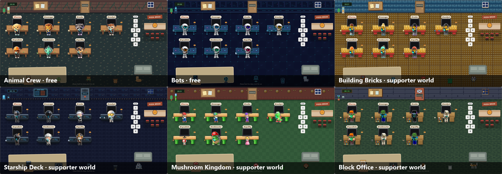
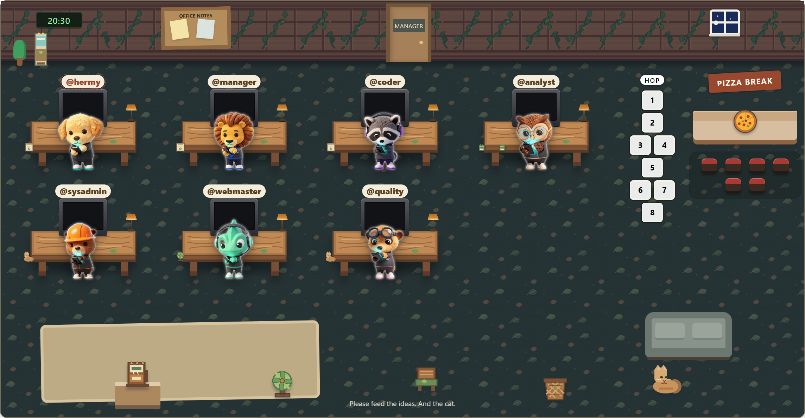
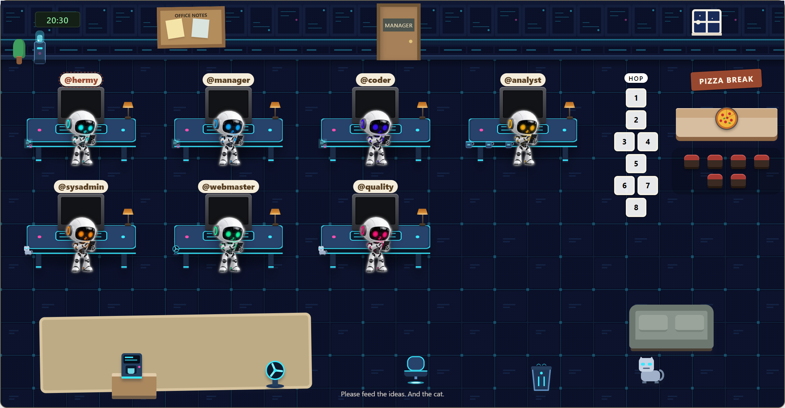
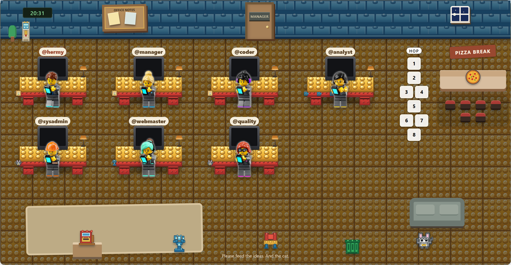
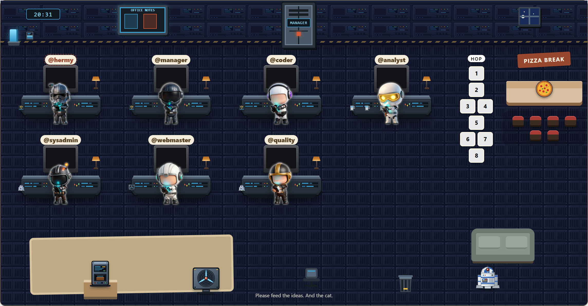
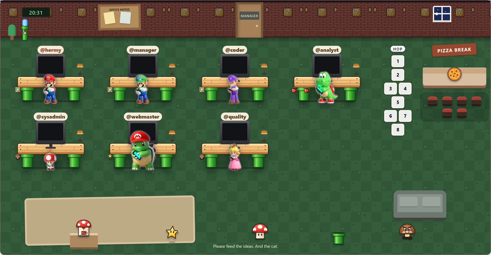
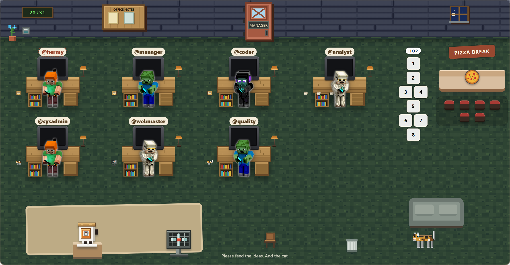
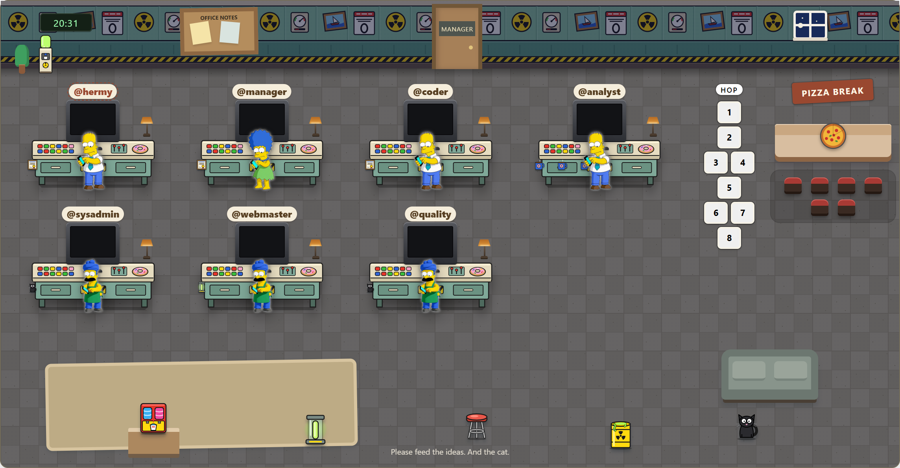
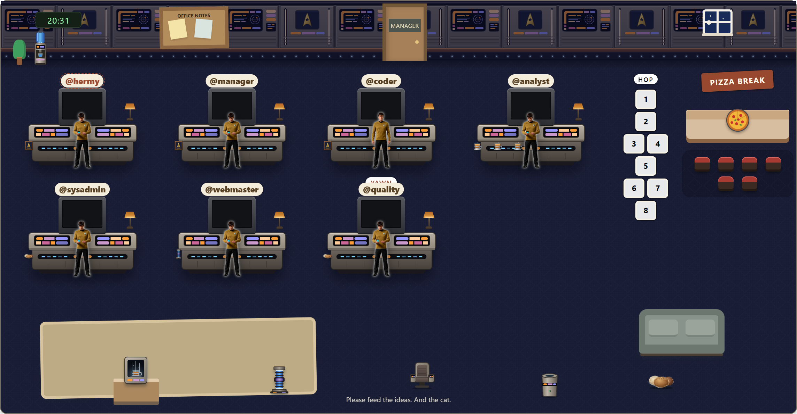

# Pixel Office Worlds

**Your Hermes agents deserve a better office.** Pixel Office Worlds turns the Hermes Desktop office into a living, animated place: every agent gets its own character with 13 animated moods, and with one click the whole room switches to a different world, from a woodland office full of animals to a futuristic robot lab.



Based on the wonderful [Hermes Office](https://github.com/Adolanium/hermes-office) by Adolanium. All of its office life (tasks, pizza, the boss, the cat, toy drawer scenes) is still here. Pixel Office Worlds adds:

- **Animated characters.** Each agent is an animated GIF character that thinks while it reasons, peeks while it calls tools, cheers on success, sleeps at night, shies away when you grab it, and walks to the pizza counter.
- **Switchable worlds.** Pick a world in the **World** menu. Walls, floor, desks and furniture change with it, and every agent takes on that world's character.
- **Pick a character per agent.** In **Sprites** you choose a character set and colour for each agent. The choice is remembered.
- **Three looks.** Switch between *icons*, *avatars* and *sprites*.
- **Logbook.** The office keeps a log of the last 200 finished tasks and shows agents working in background sessions.
- **Make your own world.** A world is just a folder with GIFs, SVGs and two small JSON files. Drop it into `characters/`, press **Reload**, done. No code changes.

## Free worlds

These two worlds ship with the plugin.

### Animal Crew · Woodland Office

A retriever, a lion manager, a raccoon coder, an owl analyst, a beaver sysadmin, a chameleon webmaster and a meerkat in quality assurance.



### Bots · Futuristic Lab

Seven little robots in a glowing night-shift lab.



## More worlds for supporters ☕

There are more worlds, each fully animated with seven characters and its own room:

| | |
|---|---|
|  **Building Bricks** |  **Starship Deck** |
|  **Mushroom Kingdom Office** |  **Block Office** |
|  **Sector 7G** *(in progress)* |  **Starfleet Bridge** *(in progress)* |

**Want them?** [Buy me a coffee](https://buymeacoffee.com/oxekklfcg) with **USD 15 or more** and leave your e-mail address in the message. You'll get the world packs sent to you, including the worlds still in progress once they're finished. Unzip a pack into `characters/` and press **Reload** in the World menu.

[](https://buymeacoffee.com/oxekklfcg)

## Install

You need Hermes Desktop and Git.

```powershell
cd $env:LOCALAPPDATA\hermes\desktop-plugins
git clone https://github.com/zimmerlis/pixel-office-worlds
```

Then press Ctrl+K in Hermes and choose **Reload desktop plugins**. Open **Pixel Office Worlds** in the sidebar, open **Sprites** and switch the mode to *sprites*, then pick a world under **World**.

Pixel Office Worlds runs next to the original *Hermes Office*: it has its own plugin ID (`pixel-office-worlds`), its own page and its own settings, so you can keep both installed.

To update later:

```powershell
cd $env:LOCALAPPDATA\hermes\desktop-plugins\pixel-office-worlds
git pull
```

Supporter worlds live in `characters/` too, but Git ignores them, so `git pull` never touches them.

## Build your own world

See [characters-readme.md](characters-readme.md) for the full format. In short:

```
characters/
  my-world/
    sprites.json          name, colours, mood aliases
    blue_idle.gif         <colour>_<mood>.gif, one per colour and mood
    blue_think.gif
    …
    world/
      world.json          wall, floor, desk and props of the room
      wall.svg  floor.svg  desk.svg  props/…
```

Moods: `idle`, `think`, `peek`, `held`, `failed`, `sleep`, `pet`, `clap`, `stretch`, `shy`, `bored`, `walkfront`, `walkback`. Every mood is optional; missing ones fall back to `idle`. GIFs of 256×256 px are plenty.

## Screenshots

The pictures in this README are made with the real plugin:

```powershell
npm install --prefix tools/preview
node tools/screenshots/capture.mjs            # every world in characters/
node tools/screenshots/capture.mjs animals    # just one
```

They land in `assets/screenshots/`. You need Chrome or Edge (or set `CHROME` to a browser path).

---

# Everything the office does

The rest of this page describes the office itself, as built by Hermes Office.

## Work at the desks

Pick a bot by its nameplate, enter a task in the bottom bar, and press Send. An envelope flies to its desk. Each task goes into that bot's existing forever **Bot Chat**, keeping its history in one conversation. Double-click a nameplate or choose **open chat** to go there.

Confirmed completions earn a star, leave a parcel on the desk, and send the bot toward the pizza counter. A fresh pizza arrives whenever a task starts. The first finisher to reach the counter gets the slice. Click a parcel or the news notice to open the result.

Session-scoped questions and approval requests make the bot raise a hand. Choose **Raised hand · open question** or the header's needs-input notice to open the corresponding chat. The Office never answers approvals itself. Failed and unconfirmed tasks retain their recovery controls and never earn completion rewards.

## Life on the carpet

The room now stays compact on large screens, with a furnished coffee area, sofa, noticeboard, and manager's door. Desks have legs and keyboards.

The boss sometimes comes through the manager's door, visits two desks with a clipboard, then leaves. Idle workers head back to their desks and react according to their personalities. Busy workers keep working. You can trigger a visit with **Toy drawer → Call the boss**. A visit lasts twenty seconds and records an incident in the newspaper, without awarding task stars.

**Personalities** lets you give each bot a lasting quirk. Mug collectors accumulate mugs on their desks and visit the coffee machine. Tidiers inspect the paper bin. Victory enthusiasts celebrate loudly through movement, while quiet achievers deliver without confetti. Button investigators gravitate toward the fan. Quirks also change idle remarks and poses. Bots remember incidents they took part in and bring them up later.

**Toy drawer** starts a short scene:

- Release a wind-up mouse for the cat to chase.
- Ice the carpet and send the rolling chair sliding.
- Drop a beach ball near the fan.
- Ring the lunch bell and call idle bots to pizza.
- Switch off gravity and watch the props float.
- Provoke a paper-spewing printer.
- Order an enormous plant.
- Invite a tiny UFO to inspect the wall portrait.

Scenes unfold in three stages over twelve seconds. Idle bots investigate and exchange remarks. Working bots, held bots, and musical-chairs players are excluded from casting. A bot that starts work during a scene stops participating. **End scene** stops the scene early without recording an invented ending.

**Office energy** controls spontaneous antics. **Quiet** leaves scenes to you; **A little odd** allows occasional incidents; **Chaos** brings them closer together. The first spontaneous incident waits at least 90 seconds, then completed scenes have a three-minute or 45-second cooldown. Ordinary personality visits happen about every 24 seconds outside Quiet mode. No sounds play.

## Make it yours

**Furnish** opens the furniture list. The coffee machine, fan, rolling chair, paper bin, and cat are available immediately. Use any placed object to start its related scene. Put objects away or choose **Arrange furniture**, then drag them around the lounge below the desks. Keyboard users can focus an object and move it with the arrow keys. Positions and visibility survive plugin reloads.

Real completed tasks unlock keepsakes:

| Completed tasks | Keepsake |
| --- | --- |
| 1 | First delivery certificate |
| 5 | Fish tank |
| 10 | Suspicious button |
| 20 | Pizza hall of fame |

The **Office newspaper** opens *The Carpet Chronicle*, with the weekly task, pizza, and hopscotch recap. Its latest 60 records include completed tasks, pizza claims, and finished incidents. Select a record to see who was present and the furniture arrangement saved with it. These are miniature scene records, not screenshots or replays of your conversations. Work prompts and result text are not copied into the newspaper.

The office also keeps the original petting, dragging, blinking, sleeping, hopscotch, musical chairs, hourly breaks, day/night window, warm desk lamps, and employee-of-the-month portrait. Tap a bot to pet it; hold it still to let it sleep. With a bot selected, arrows nudge it, Shift makes larger steps, Enter opens its chat, and P pets it. **Back to desk** sends a wandering bot home.

Reduced-motion settings disable decorative bouncing, spinning, and incident animations. Task controls remain separate from the scene controls. Large rosters scroll inside the room, with furniture below the desks. In sprites mode, the room follows the chosen world.

## Preview and tests

```powershell
npm ci --prefix tools/preview
node tools/preview/build.mjs
node tools/preview/serve.mjs
```

Open [the interactive preview](http://localhost:4877/preview.html). It renders the actual plugin with a local SDK stand-in and simulated six-second tasks. Its storage is isolated from Hermes.

```powershell
node --test tests/*.test.mjs
```

## Catalog package

The `catalog/` directory is the Hermes catalog package inherited from Hermes Office. It contains only `plugin.js`, so it shows the office without any character worlds. Use the Git install above to get the worlds. After changing the root `plugin.js`, run `python scripts/build_catalog.py` and commit the `catalog/` files; CI checks that they are current.

## Credits and license

Office, scenes and catalog packaging: [Hermes Office](https://github.com/Adolanium/hermes-office) by Adolanium. Worlds, animated characters and the world system: René Zimmerli. MIT licensed, see [LICENSE](LICENSE).
